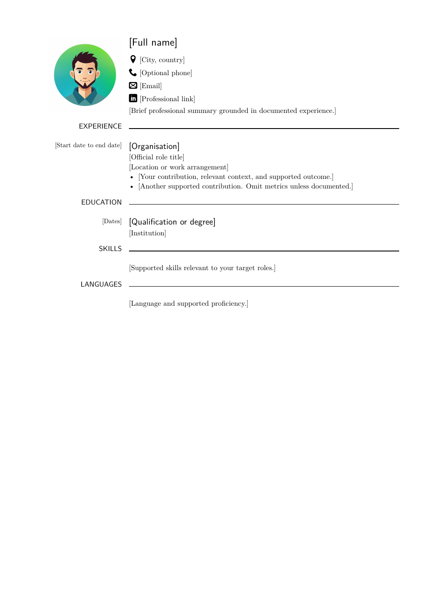
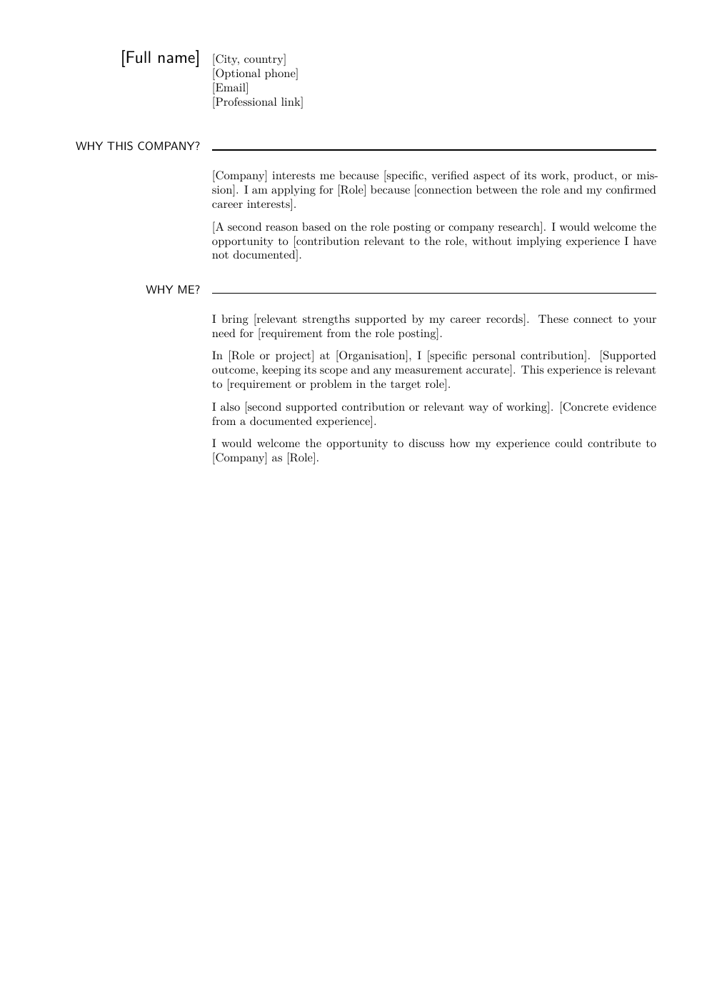

# Career tracker template

A personal workspace for your career history and job applications. Keep a detailed factual record once, then use it to prepare accurate CVs, application answers, and interview stories with an AI agent.

This template contains placeholders only. Replace bracketed text with your own information. Examples are structure and writing guidance, never evidence about you. It works for any profession and does not require LaTeX.

## Start your own repository

Copy this folder without its `.git` directory, or use it as a repository template if its owner enables that feature on their hosting service. For a local copy:

```sh
mkdir ../my-career-tracker
rsync -av --exclude='.git' ./ ../my-career-tracker/
cd ../my-career-tracker
git init -b main
```

Open the new folder in your AI coding agent. Ask it to read `AGENTS.md` before editing. Prefer a private repository once it contains your personal information. Review files before committing; `sources/` and `exports/` are ignored by default, but the Markdown career records and application drafts are tracked.

## Initialise from your existing CV

Attach your CV as a PDF to the conversation, or place it in `sources/`. You can also supply Markdown, a Word document, pasted text, or notes. Do not commit the original document unless you deliberately want it in Git. An attachment may need to be attached again in another conversation.

Start with this prompt:

> Read README.md and AGENTS.md. Initialise my career records using the CV I attached. Extract its text and check its layout so dates, columns, and roles are interpreted correctly. If it is scanned, use OCR if available and flag uncertain text. Fill career/profile.md, career/experience.md, career/work-summaries.md, and career/cv.md using only supported facts. Record the source filename and import date, preserve relevant source wording verbatim, and mark missing details as “not yet documented”. Treat template examples as placeholders, not facts. List ambiguities and ask focused questions. Do not overwrite conflicting existing information. My preferred output format is [PDF through LaTeX / Word / another format], using [attached template / cv-tex/example.tex / describe your format]. Record that choice in career/profile.md.

The first import is a starting point: a CV often omits the context, personal contribution, and outcomes needed for useful work summaries. Review the import and answer the agent's questions. Add project notes or describe your work in your own words to enrich the record. Missing evidence stays explicit until you supply it.

After reviewing, save a first snapshot:

```sh
git add .
git commit -m "Initialise career records"
```

## Build your work summaries through conversation

A CV tells only a small part of your experience. Detailed [work summaries](career/work-summaries.md) give the agent the evidence it needs to write strong, specific CV bullets: the problem, your contribution, the decisions you made, and what happened as a result. They also give you a reliable source for interview preparation, so you can revisit the details behind a bullet and explain your work consistently.

Open a new conversation with your agent and start talking about one story. It can be a project, a difficult decision, a collaboration, a failure, or something you improved. Tell it in your own words, by typing or using voice if your tool supports it. You do not need to arrive with a polished STAR answer.

Start with this prompt:

> Read AGENTS.md and career/work-summaries.md. I want to capture a work story for future CVs and interviews. Here is what happened: [tell the story in your own words]. Ask focused follow-up questions, one or a small group at a time, to understand the situation, my task, what I personally did, and the result. Ask about decisions, trade-offs, collaborators, dates, and evidence for outcomes where useful. Save the supplied facts incrementally in career/work-summaries.md as a first-person STAR summary, preserve my original wording verbatim under Raw source text, and leave anything I have not supplied as “not yet documented”. Keep this record factual and plain. Do not turn it into application copy or make the story sound more successful than it was. Flag contradictions before changing existing records.

Let the agent ask for the missing context. Useful questions include what made the problem difficult, which decisions were yours, what others contributed, whether the work shipped, and how you know the outcome. Qualitative results are useful too; do not invent a metric just to make a bullet stronger. For failures or difficult decisions, capture what happened and what you learned without rewriting the outcome.

Review the saved summary and correct any misunderstanding. Preserve both the STAR version and the raw source text. Add later details as you remember or confirm them, keeping uncertainty explicit. Repeat this process for other stories over time.

Keep `career/work-summaries.md` factual, including limitations, unfinished work, mistakes, and missing evidence. Each application can select, condense, and polish those facts into persuasive CV bullets, cover letters, answers, and interview notes in `applications/<company>/<role>/`. The wording and emphasis can change for the audience; the underlying facts cannot. Do not copy that polished application narrative back over the factual story.

## Repository map

| Path | Purpose |
| --- | --- |
| `AGENTS.md` | Working instructions for the AI agent |
| `career/profile.md` | Personal details, preferences, skills, and output format |
| `career/experience.md` | Detailed factual record, with sources and unknowns |
| `career/work-summaries.md` | First-person STAR stories and verbatim raw source text |
| `career/cv.md` | Master Markdown CV |
| `applications/job-tracker.md` | Opportunity status, deadlines, and next actions |
| `applications/<company>/<role>/` | Workspace for each application |
| `templates/application/` | Files to copy when starting an application |
| `cv-tex/example.tex` | Optional LaTeX CV layout with placeholder content |
| `templates/application/cover-letter.md` | Optional cover-letter content example |
| `cv-tex/cover-letter-example.tex` | Matching LaTeX cover-letter layout |
| `cv-tex/README.md` | How to use and compile the LaTeX example |
| `sources/` | Local originals such as CVs, ignored by Git |
| `exports/` | Local rendered documents, ignored by Git |

Create only the application files you need. Keep the master CV general; keep tailored versions in the application folder.

## Apply to a position

Start a **new conversation in this repository for each application**. Supply the job URL or full posting, company name, and any form questions, constraints, deadlines, or recruiter correspondence. Keep the conversation focused on that opportunity. Follow these steps in order; you can pause and review between them.

### 1. Investigate the opportunity and gather facts

> Read AGENTS.md and the career records. I want to apply to [company] for [role]. Here is the posting: [URL or pasted text]. Create applications/[company]/[role]/ from templates/application/ and add this opportunity to applications/job-tracker.md. Investigate the company, role, and application process using primary sources. Save links and access dates in research.md, distinguish verified facts from interpretation, and assess fit against my documented experience in role-analysis.md. Capture the application questions, limits, deadline, and requirements in application-form.md. Put missing candidate facts and decisions in questions-for-user.md and ask focused questions before making unsupported claims. If you discover useful new career information in our conversation, ask whether to save it in career/.

The agent should gather enough evidence to identify relevant experience and gaps before drafting. If a page is inaccessible, paste its contents or provide screenshots. Research notes should state what could not be verified.

### 2. Tailor the Markdown CV

> Tailor career/cv.md for this role and save the result as applications/[company]/[role]/cv.md. Use career/work-summaries.md and career/experience.md to turn relevant, supported stories into specific bullets that answer the posting. Keep the factual work summaries unchanged when polishing application wording. Keep dates, titles, scope, and outcomes accurate. Ask for missing evidence when needed, explain the main changes, and flag gaps for my review.

Review the Markdown for relevance and factual accuracy before rendering. Tailoring may change emphasis and wording; it must not turn a proposal into a delivered result or invent achievements.

### 3. Prepare the application details

> Draft the answers in application-answers.md using the captured form fields and my confirmed background. Respect word and character limits. Prepare a cover letter only if requested or useful, using templates/application/cover-letter.md as an optional starting point. Replace all placeholders with evidence-backed content. Flag fields that require my choice or additional facts, including compensation, work authorisation, availability, and declarations. Update the application README and tracker with the current stage and next action. Prepare everything for my review; do not submit the application or send messages.

Review every answer, required attachment, and factual or legal declaration. Record actual submission dates and follow-ups only after they occur. You can explicitly ask the agent to enter reviewed answers into a form if its tools support that; submitting or sending requires your explicit instruction.

### 4. Produce the final CV in your chosen format

> Convert the reviewed applications/[company]/[role]/cv.md to my chosen output format using the rendering preferences in career/profile.md. Preserve my template's layout where available and synchronise its content with the Markdown. If using the bundled LaTeX example, create applications/[company]/[role]/cv.tex and compile it to exports/[company]-[role]-cv.pdf. Check the output visually and verify extracted text, dates, links, and page breaks. Report any compilation or rendering limits and link the final file.

Markdown is the content source. LaTeX, Word, HTML, or another renderer is a presentation choice. For a Word template, produce an editable `.docx` and export a PDF if required. If your tools cannot render the chosen format, retain the completed source and give the exact remaining step instead of claiming a successful export.

## Maintain your records

Add confirmed background to `career/`, then reuse it across applications. Keep raw wording beneath work summaries and preserve uncertainty. During application conversations, the agent should ask before adding newly supplied information to the lasting career record. Update the tracker with real status changes and the next action so a fresh conversation can resume from the files.

## Example CV layout

The bundled LaTeX example includes a placeholder photo and contact icons. See the [rendered example PDF](cv-tex/example.pdf) and [LaTeX instructions](cv-tex/README.md). Replace the placeholders and example image before using it for an application.



## Example cover letter

The [Markdown example](templates/application/cover-letter.md) and [LaTeX example](cv-tex/cover-letter-example.tex) contain matching placeholders, organised around “Why this company?” and “Why me?”. Use researched company facts and supported personal contributions to replace them. See the [rendered PDF](cv-tex/cover-letter-example.pdf) for the layout.


